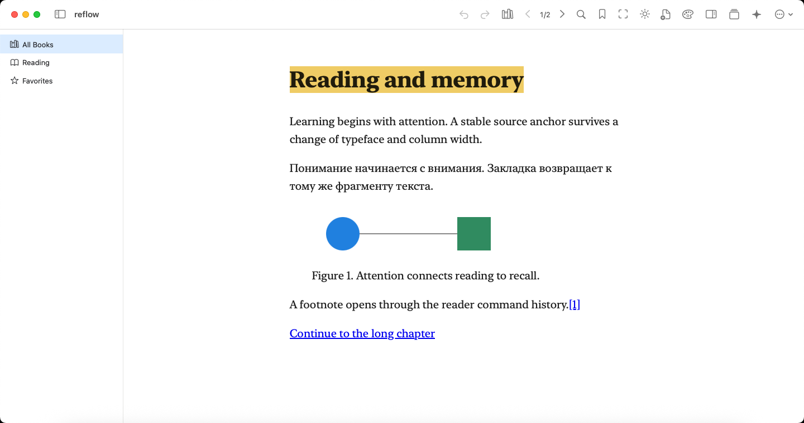

# Adaptive Reader

**A native reading workspace for macOS.** Read PDF and EPUB offline, keep your place across sessions, and turn passages into source-linked notes, cards, and connections.

[](docs/distribution.md)
[](AdaptiveReader.xcodeproj)
[](LICENSE)
[](https://github.com/karavaevflow/adaptive-reader/actions/workflows/ci.yml)



## Download

> **Release status:** v1.0 is still a candidate. The published [rc.1 release](https://github.com/karavaevflow/adaptive-reader/releases/tag/v1.0.0-rc.1) has a known PDF repeated-page/navigation bug. Its corrected rc.2 build is being validated in [PR #7](https://github.com/karavaevflow/adaptive-reader/pull/7); do not treat rc.1 as the recommended download. The [hotfix ledger](docs/v1.0-rc.2.md) records current evidence.

| Route | What you get | Status |
| --- | --- | --- |
| [GitHub Releases](https://github.com/karavaevflow/adaptive-reader/releases) | Universal `.zip` app and SHA-256 checksum | Public rc.1 has the PDF defect; rc.2 pending |
| [Build from source](#build-from-source) | A local development build in Xcode | Available now with full Xcode |

The app requires **macOS 15.0 or later** and supports Apple silicon and Intel. Published candidates are **ad-hoc signed, without Developer ID signing or notarization**. Read [installation, Gatekeeper, updates, and backup guidance](docs/distribution.md) before replacing an installed copy. No Homebrew cask or automatic updater is published yet.

## What it does

- **Read locally:** import a managed copy or keep a read-only link to a PDF/EPUB; verify the source checksum on reopen. Search, select, follow links, bookmark, switch PDF palettes, and restore your position.
- **Make room for reading:** Focus, Spotlight, Mini Reader, timed sessions, auto-scroll, scheduled palettes, and an offline Command Center (`⌘K`). A manual gesture stops auto-scroll; closing the reading window stops the session.
- **Study with the source in reach:** EPUB reflow, highlights, notes, editable cards, Recall, Markdown export, and on-device Listen & Read. Notes, citations, and cards use versioned source anchors.
- **Connect books:** local cross-book search, comparison, Canvas relationships, Timeline, and editable reading paths. Split and Bilingual Reading, per-page Vision OCR, and optional private Replay/Insights extend the workspace.
- **Choose AI explicitly:** the PDF Companion can use a configured local Ollama model or a consented HTTPS endpoint. It is off by default, makes no request when opening a book, and cites source passages. No model is bundled. [Data handling](PRIVACY.md) · [integration limits](docs/v0.3.md).

The interface supports English and Russian, System/Light/Dark shell themes, compact layouts, keyboard commands, and macOS accessibility settings. The PDF Color Engine keeps selection and links in PDFKit and returns complex pages to Original when selective recoloring is unsafe. [Design system](docs/adaptive-design-system.md) · [reader architecture](docs/reader-architecture.md) · [Color Engine research](Research/README.md).

<details>
<summary>Useful keyboard commands</summary>

| Shortcut | Action |
| --- | --- |
| `⌘O` / `⇧⌘O` | Import a copy / linked book |
| `⌘F` | Search the current book or library |
| `⌘D` | Toggle a bookmark |
| `⌘K` | Open Command Center |
| `⇧⌘F` / `Esc` | Enter / leave Focus |
| `⌘[` / `⌘]` | Smart Back / Forward |
| `⇧⌘L` | Open Study |
| `⇧⌘J` | Open Knowledge |
| `⇧⌘E` | Open Extended Reading |
| `⇧⌘W` | Close the current book |

</details>

## Build from source

Install full Xcode, select it in **Xcode → Settings → Locations → Command Line Tools**, then clone and build:

```sh
git clone https://github.com/karavaevflow/adaptive-reader.git
cd adaptive-reader
git switch codex/public-stable-v1.0
swift test --no-parallel
xcodebuild -project AdaptiveReader.xcodeproj -scheme AdaptiveReader -destination 'platform=macOS' build
```

Open `AdaptiveReader.xcodeproj` and run the shared `AdaptiveReader` scheme for a development app. The command-line test scheme, UI acceptance, and universal Release packaging run in [macOS CI](.github/workflows/ci.yml). `swift run AdaptiveReaderPreview` launches the development executable. [Reproducible candidate packaging](docs/distribution.md) records the release toolchain and checks.

## Project status and documentation

| Area | Evidence |
| --- | --- |
| Foundation, offline PDF, daily reading | [Phase 0](docs/phase-0.md) · [v0.1](docs/v0.1.md) · [v0.2](docs/v0.2.md) |
| AI, EPUB, study, connected knowledge, extended reading | [v0.3](docs/v0.3.md) · [v0.4](docs/v0.4.md) · [v0.5](docs/v0.5.md) · [v0.6](docs/v0.6.md) |
| Current 1.0 candidate | [rc.2 validation](docs/v1.0-rc.2.md) · [stable release gates](docs/release-gates.md) · [changelog](CHANGELOG.md) |
| Safety and contribution | [Privacy](PRIVACY.md) · [Security](SECURITY.md) · [Contributing](CONTRIBUTING.md) · [Licenses](NOTICE.md) |

Stable v1.0 remains gated on a green candidate CI run, exact macOS 15.0 runtime, fresh system accessibility review, and downloaded installation/update checks. Real-model evaluation remains deferred. See the linked ledger for what has actually been tested; a prerelease label does not imply those gates passed.

**License:** [MIT](LICENSE). Third-party notices are in [NOTICE.md](NOTICE.md).
