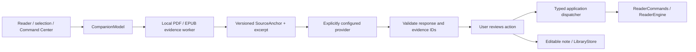

# Reader contracts

ReaderCore contains domain contracts, native PDF/EPUB engines, source identity and local storage. The SwiftUI shell owns ReaderSession; each engine owns its native reading surface. Page rendering never owns navigation state.

## Stable boundaries

- `ReaderEngine` exposes source identity, capabilities, current anchor, validated navigation, scale, palette commands and asynchronous text search. Unsupported operations throw. EPUB supports validated typography reflow and rejects PDF zoom/Spotlight/Mini Reader without changing bookmark, note or AI source contracts.
- `SourceAnchor` schema 1 stores book UUID, source SHA-256 and a typed position. PDF positions use zero-based pages and unrotated crop-box coordinates. EPUB positions store a resource and stable textual locator. Unsupported versions, changed sources and invalid locators produce explicit errors. Reflow does not use PDF coordinates.
- `ReaderCommands` is the typed entry point for menu, toolbar and reviewed AI reader actions. It commits state/history only after the engine succeeds. Palette undo uses the same validated engine path. New commands must declare capability checks and undo semantics. AI proposals reach the same dispatcher through a validated application handler; models receive evidence IDs and text, never native views or file access.
- `PDFReaderEngine` uses PDFKit for search, selection, links and currentDestination. `AdaptivePDFPage` alters drawing only after the research eligibility check. Palette redraw rebinds the same PDFDocument through public PDFKit APIs, then restores the anchor and scale. No private tile APIs or PDF rewriting are used.

Search yields `ReaderSearchMatch` values containing a versioned SourceAnchor and a text snippet. The native PDFSelection stays private to PDFReaderEngine. Selecting a match uses the same typed command dispatcher as navigation. New queries, source changes and session closure cancel pending searches. Results are capped at 1,000 with a visible refine-query message. Text availability is checked on a separate PDFDocument owned by a background worker; no PDFKit object crosses actors. Source hashing also runs off the main actor.

## Storage schema 3

Under Application Support/AdaptiveReader (inside the app sandbox), Assets stores immutable managed copies, Books stores versioned metadata, ReadingState stores positions/palette/scale, Annotations stores bookmarks, and Cache is disposable. A shared LibraryStore actor per storage root serializes atomic writes, including bookmark/favorite read-modify-write operations across windows.

BookRecord schema 3 adds explicit PDF/EPUB format and correct managed-asset extensions. It records a managed asset name or a read-only security-scoped bookmark, plus favorite state, import date and page count. Schema-1/2 metadata upgrades atomically as PDF on read; migration tests preserve the exact asset bytes, source identity and reading position. ReadingState and SourceAnchor remain schema 1. Optional EPUB typography is stored with the reading state; missing typography retains defaults. Existing optional fields remain decodable. Future schema changes require the same previous-version migration test.

Reference imports create no managed asset. Access is scoped only while reading; PDFKit subsequently owns an in-memory source. Reopen checks SHA-256 before applying anchors. Stale bookmarks renew when possible. The library's Locate linked PDF action reauthorizes access only if the selected file has the original checksum, preserving the book UUID, revision and annotations. Missing/changed sources produce explicit errors.

ReaderSession debounces position saves and flushes them through a normal termination delegate before Quit completes. Native scene restoration and window frame autosave preserve windows; AppStorage preserves panel/theme settings. Each window owns its Keep Awake assertion; source switch, book closure, window disappearance and normal Quit release it. The assertion is never persisted.

The research command-line program owns global-inversion experiments and measurements. The app only contains the selected, bounded rendering path. Raster scale/cache policy can evolve within the rendering boundary without changing ReaderEngine or SourceAnchor.

## Shell commands and native focus

`WorkspaceCommand` gives native menus and toolbar a single typed dispatcher for opening a source, panels and zoom. Document operations delegate to ReaderCommands, so Command Center and AI actions share the same validation path.

Popover/sheet dismissal requests focus by semantic toolbar identifier. WindowIntegration waits for the parent NSWindow to become key, finds the actual accessibility element and restores native keyboard/accessibility focus using public AppKit APIs. This avoids relying on a fixed animation delay. Escape is handled at popover content as well as by the native presentation.

## Optional AI boundary

CompanionProvider abstracts streaming response transport. Ollama and Chat Completions implementations use bounded requests and cooperative cancellation. The model proposes a closed set of actions; the application validates capabilities, arguments and current book identity. It has no model-controlled filesystem, shell or network action executor.

EvidencePassage carries a stable ID, original text and SourceAnchor. PDFEvidenceIndex builds from the immutable opened source on an independent worker and uses bounded BM25 retrieval. Cache schema 2 preserves paragraph horizontal coordinates and discards/rebuilds schema 1. SourceAnchor remains schema 1. EPUB locators already round-trip through the evidence/request contract; EPUBReaderEngine and EPUBEvidenceIndex now supply resource/text locators to the same pipeline, using the shared format-independent ranker. The EPUB index is bounded disposable memory; PDF disk-cache serialization remains unchanged.

AISettings schema 1 is global to the library; secrets live separately in Keychain and Security IPC runs off the main actor. Configuration is re-read at request start and authorized again at the network boundary. Saving settings cancels peers sharing the store, so an old window cannot silently retain revoked cloud consent. AI is off by default and opens no network connection merely by opening a book.

Notes schema 1 is separate user data under Notes. The editor creates/removes a specific anchored note atomically through LibraryStore, preserving bookmarks and source bytes. Clearing the disposable evidence cache preserves notes and settings. Active requests, selection context, summaries and Smart Margins state are not restored as background work after launch.

## EPUB layout boundary

EPUBPublication is an immutable, bounded container snapshot with manifest resources, reading order and linked content. EPUBReaderEngine owns a nonpersistent WKWebView with a custom offline resource scheme. Sanitized XHTML retains XML text ordering, with publisher scripts/remote resources disabled. Injected reader code runs in an isolated content world. The version-1 EPUBTextLocator stores resource-local UTF-16 offset and a validation quote; deterministic encoding prevents equivalent anchors drifting due to JSON key order. Typography affects layout only, and typed commands restore the same source fragment. Tests measure its actual WebKit rectangle before and after reflow. No PDF coordinates or invented EPUB page numbers are persisted.

## Study and local speech

ReaderEngine exposes bounded source passages, persistent-highlight rendering and transient playback marking. Typed ReaderCommands apply highlights and follow playback without adding every utterance to Back history. EPUB uses canonical text offsets for geometry and separately preserves readable selection quotations; paragraph-boundary chunking avoids joining minified XHTML words. CSS custom highlights preserve original text nodes through reflow. PDF study marks are in-memory annotations reconstructed from separate user records; source assets remain immutable.

Study schema 1 stores cards, colored highlights and listening state under Study. Existing Notes schema 1 remains independent. The shared actor validates source identity and merges atomic mutations; portable card archives rebase only the library-local UUID for an identical source revision and never overwrite matching existing card IDs. Markdown has readable source labels and machine anchors in comments.

SpeechPlayer is a production ReaderCore service, reused by the performance harness. It creates AVSpeechSynthesizer only on an explicit request and queues one bounded text block at a time. Speech delegates retain only immutable utterance identity/range across the actor boundary; cancellation invalidates the active identity before stopping and releasing the synthesizer. Pause/continue intent is retained during voice startup and between utterances. Word progress checkpoints and normal-quit flush restore the same book fragment after relaunch. No app timer polls the speech service and no model call is involved.

## Knowledge workspace (v0.5)

KnowledgeSnapshot schema 1 is explicit reader-owned data under Knowledge/Memory.json: typed cards with provenance, sources, tags/comments; boards with per-card coordinates/clusters and named edges; editable source-linked reading paths; author/collection metadata. It does not change BookRecord 3, SourceAnchor 1, Notes 1 or Study 1. LibraryStore serializes atomic KnowledgeCommand mutations. Per-node placement avoids replacing unrelated board edits. Delete/Undo restores the removed card's placements/edges while preserving neighboring changes. Imported JSON preserves existing IDs/edits; absent source books remain explicit, with navigation errors rather than invented replacements.

KnowledgeSearchIndex runs extraction/ranking away from the main actor with one immutable book resident at a time. It checks original access/checksum before reading revision-keyed Cache/Knowledge data. Each source has bounded evidence; the aggregate disk cache is capped at 128 MiB. Reset replaces cached excerpts with an invalid marker and clears derived in-memory vectors, preserving original/user records. Reader-owned notes remain searchable when their original is unavailable. Search filters book IDs, titles and reader-maintained author/collection metadata; results disclose truncation and per-source errors.

Saved-card ranking uses installed Apple sentence embeddings when available, with explicit lexical fallback. A process-local content/language/model-revision cache holds at most 2,000 vectors and is invalidated after card mutations. No embedding assets are downloaded. KnowledgeCanvasLayout performs shared linear lookup/culling for SwiftUI and the Release harness; offscreen cards are not instantiated as views. Accessible movement commands use the same persisted placement command as dragging.

The existing application dispatcher opens Knowledge from native menus, toolbar, More and Command Center, and source return uses ReaderCommands.navigate after cross-book access/revision checks. Library AI reuses existing provider configuration and destination consent. Namespaced evidence IDs disambiguate identical source files imported as different books. CompanionScope.library forbids executable actions, and comparison validation requires citations from at least two books. Explicitly chosen bounded excerpts, titles and the question are the only context. Opening/searching/indexing sends no model request. Settings changes cancel affected Knowledge requests as well as Companion requests.

Timeline uses actual EPUB chapters/PDF outlines plus saved reader ideas; absent outlines do not become fabricated chapters. Goal-based reading routes come from the current matching excerpts, are editable and do not claim exhaustive coverage. Source navigation is unchanged by presentation/layout edits.

## Extended reading (v0.6)

ReaderEngineFactory constructs independent PDF/EPUB engines. SplitPane owns its own ReaderCommands, position, palette and native view; it never recursively creates another ReaderSession. The primary pane retains the existing dispatcher. Second-pane controls use that pane's typed commands. Synchronization is opt-in and limited to identical book identity/revision; active-pane ownership prevents navigation feedback loops. Swap reopens each source with its original anchor. The secondary anchor/palette is stored separately from the primary ReadingState, including when both panes show the same source. A native surface transition captures the primary anchor before reparenting, restores it after layout and rebinds PDF clip-view notifications. Normal quit/window-close flush waits for pending split-position writes. Existing sidebar/inspector commands remain available in Split: native panels use wider layout thresholds, with compact sheets/popovers through the same dispatcher. Secondary previous/back/passage commands move into More when space is constrained.

DocumentOCR confines CGPDFDocument, raster and VNRecognizeTextRequest to a utility worker. It explicitly selects a supported CPU compute device for each Vision stage and requests background processing, avoiding reliance on GPU availability. It renders one crop box at a time, using the actual PDF drawing transform and its inverse to map normalized Vision bounds back to unrotated PDF coordinates, including crop origin and intrinsic rotation. Rasters are capped at 2400 px on the longest edge (and 3× scale); page text is capped at 100,000 UTF-16 units. Cancellation invalidates the operation identity, cancels the active Vision request and awaits worker completion before releasing request references. Encrypted/copy-restricted sources are rejected. OCR is explicitly requested per current PDF page; it is not a background whole-library job or an OCR accuracy guarantee for diagrams, formulas or reading order.

OCRPage schema 1 is derived data under `Cache/OCR/<book>/<revision>/<page>.json`. ReaderEngine retains at most 16 recognized pages. Recognized lines expose confidence and canonical SourceAnchor/rectangles; search supplements loaded pages consistently even if PDFKit Live Text appears asynchronously. The recognizedText capability is separate from native textSelection. Native PDF text selection is not fabricated from OCR observations. Cached pages reload on explicit recognition; search is not advertised as a full-book OCR index. Original assets are never written.

ExtendedReadingSnapshot schema 1 lives under `ExtendedReading/Memory.json` and is limited to 16 MiB. It contains source-aligned reader translations, vocabulary, the secondary position and independently opt-in Replay/Insights. All mutations use typed ExtendedReadingCommand through LibraryStore. Existing BookRecord, ReadingState, Notes, Study, Knowledge and SourceAnchor schemas are unchanged. Replay retains at most 10,000 events with source/action/date metadata, never raw question text, screen capture or external activity. Clearing/disabling tracking rotates a generation token; queued old writes are ignored by the store actor. Clearing either history does not remove translations or source assets.

Insights uses ActiveReadingClock's own monotonic timestamps, independently of the scroll driver's capped animation delta. It counts only an active visible reading window after recent interaction, assigns samples to the active pane's book and bounds long-stall samples to two seconds. Pending time is checkpointed on source changes and normal exit. Completion is explicitly marked by the reader; metrics do not infer comprehension. Bilingual explanations prepare a selected-source Companion draft; the configured provider is contacted only on Ask, through the existing consent/validation boundary. No translation model or language assets are installed automatically.
