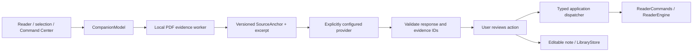

# Reader contracts

ReaderCore contains domain contracts, the native PDF engine, source identity and local storage. The SwiftUI shell owns ReaderSession; the engine owns its PDFView. Page rendering never owns navigation state.

## Stable boundaries

- `ReaderEngine` exposes source identity, capabilities, current anchor, validated navigation, scale, palette commands and asynchronous text search. Unsupported operations throw. EPUB can support reflow and reject page palettes without changes to bookmarks, notes or AI tools.
- `SourceAnchor` schema 1 stores book UUID, source SHA-256 and a typed position. PDF positions use zero-based pages and unrotated crop-box coordinates. EPUB positions store a resource and stable textual locator. Unsupported versions, changed sources and invalid locators produce explicit errors. Reflow does not use PDF coordinates.
- `ReaderCommands` is the typed entry point for menu, toolbar and reviewed AI reader actions. It commits state/history only after the engine succeeds. Palette undo uses the same validated engine path. New commands must declare capability checks and undo semantics. AI proposals reach the same dispatcher through a validated application handler; models receive evidence IDs and text, never native views or file access.
- `PDFReaderEngine` uses PDFKit for search, selection, links and currentDestination. `AdaptivePDFPage` alters drawing only after the research eligibility check. Palette redraw rebinds the same PDFDocument through public PDFKit APIs, then restores the anchor and scale. No private tile APIs or PDF rewriting are used.

Search yields `ReaderSearchMatch` values containing a versioned SourceAnchor and a text snippet. The native PDFSelection stays private to PDFReaderEngine. Selecting a match uses the same typed command dispatcher as navigation. New queries, source changes and session closure cancel pending searches. Results are capped at 1,000 with a visible refine-query message. Text availability is checked on a separate PDFDocument owned by a background worker; no PDFKit object crosses actors. Source hashing also runs off the main actor.

## Storage schema 2

Under Application Support/AdaptiveReader (inside the app sandbox), Assets stores immutable managed copies, Books stores versioned metadata, ReadingState stores positions/palette/scale, Annotations stores bookmarks, and Cache is disposable. A shared LibraryStore actor per storage root serializes atomic writes, including bookmark/favorite read-modify-write operations across windows.

BookRecord schema 2 records a managed asset name or a read-only security-scoped bookmark, plus favorite state, import date and page count. Schema-1 metadata upgrades atomically on read; migration tests preserve the exact asset bytes, source identity and reading position. ReadingState and SourceAnchor remain schema 1. Their existing optional fields remain decodable. Future schema changes require the same previous-version migration test.

Reference imports create no managed asset. Access is scoped only while reading; PDFKit subsequently owns an in-memory source. Reopen checks SHA-256 before applying anchors. Stale bookmarks renew when possible. The library's Locate linked PDF action reauthorizes access only if the selected file has the original checksum, preserving the book UUID, revision and annotations. Missing/changed sources produce explicit errors.

ReaderSession debounces position saves and flushes them through a normal termination delegate before Quit completes. Native scene restoration and window frame autosave preserve windows; AppStorage preserves panel/theme settings. Each window owns its Keep Awake assertion; source switch, book closure, window disappearance and normal Quit release it. The assertion is never persisted.

The research command-line program owns global-inversion experiments and measurements. The app only contains the selected, bounded rendering path. Raster scale/cache policy can evolve within the rendering boundary without changing ReaderEngine or SourceAnchor.

## Shell commands and native focus

`WorkspaceCommand` gives native menus and toolbar a single typed dispatcher for opening a source, panels and zoom. Document operations delegate to ReaderCommands, so Command Center and AI actions share the same validation path.

Popover/sheet dismissal requests focus by semantic toolbar identifier. WindowIntegration waits for the parent NSWindow to become key, finds the actual accessibility element and restores native keyboard/accessibility focus using public AppKit APIs. This avoids relying on a fixed animation delay. Escape is handled at popover content as well as by the native presentation.

## Optional AI boundary

CompanionProvider abstracts streaming response transport. Ollama and Chat Completions implementations use bounded requests and cooperative cancellation. The model proposes a closed set of actions; the application validates capabilities, arguments and current book identity. It has no model-controlled filesystem, shell or network action executor.

EvidencePassage carries a stable ID, original text and SourceAnchor. PDFEvidenceIndex builds from the immutable opened source on an independent worker and uses bounded BM25 retrieval. Cache schema 2 preserves paragraph horizontal coordinates and discards/rebuilds schema 1. SourceAnchor remains schema 1. EPUB locators already round-trip through the evidence/request contract; an EPUB engine/indexer remains a later milestone.

AISettings schema 1 is global to the library; secrets live separately in Keychain and Security IPC runs off the main actor. Configuration is re-read at request start and authorized again at the network boundary. Saving settings cancels peers sharing the store, so an old window cannot silently retain revoked cloud consent. AI is off by default and opens no network connection merely by opening a book.

Notes schema 1 is separate user data under Notes. The editor creates/removes a specific anchored note atomically through LibraryStore, preserving bookmarks and source bytes. Clearing the disposable evidence cache preserves notes and settings. Active requests, selection context, summaries and Smart Margins state are not restored as background work after launch.
